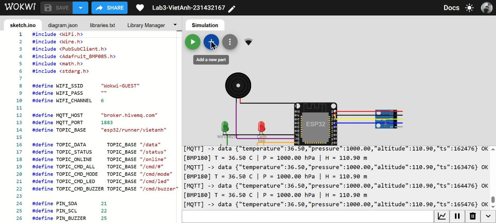
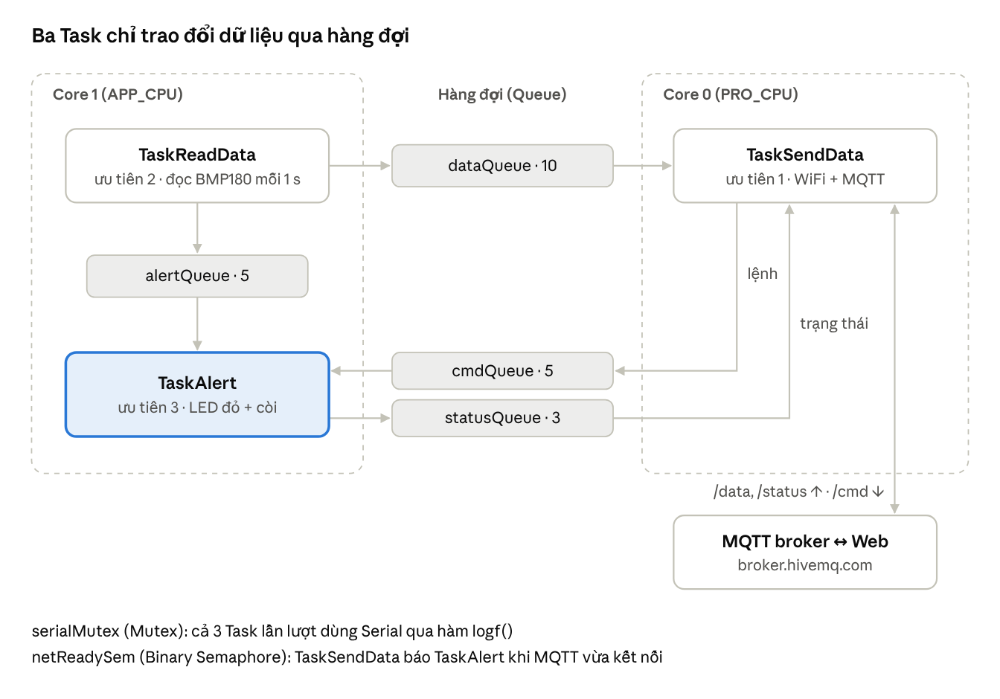
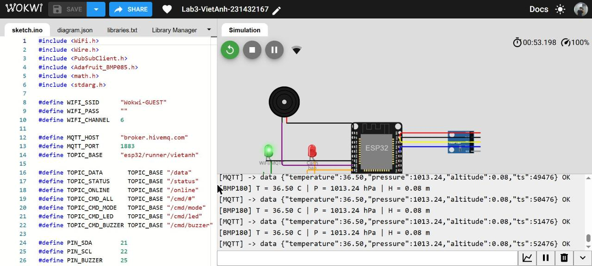
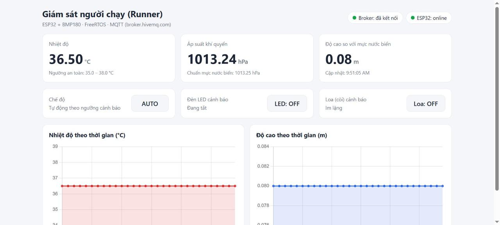
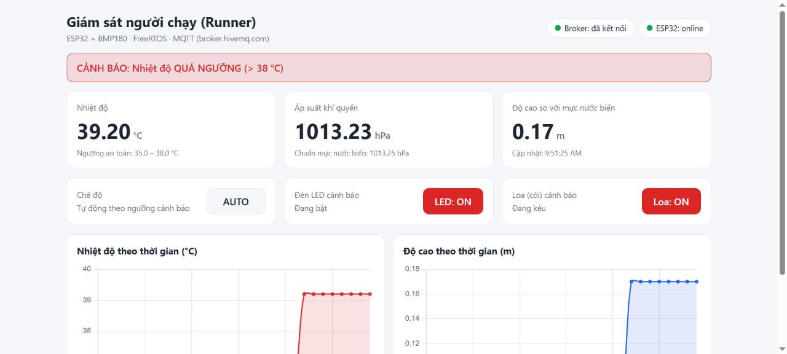
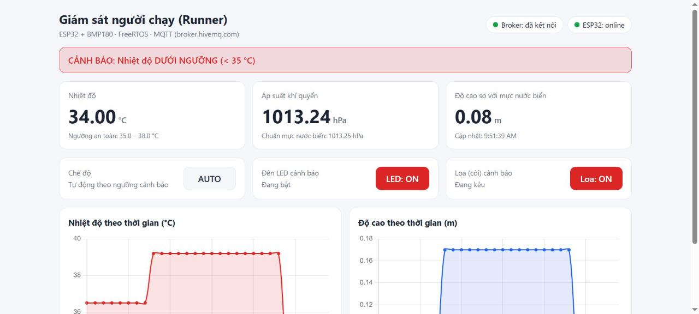
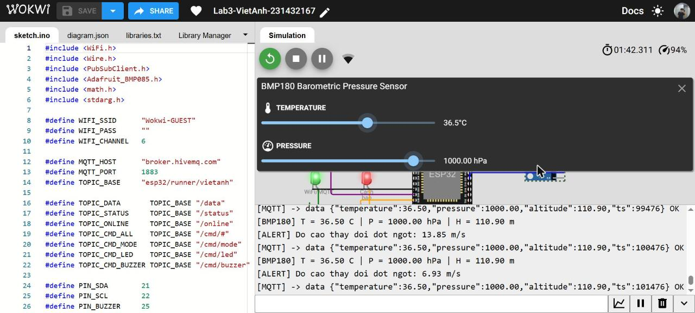
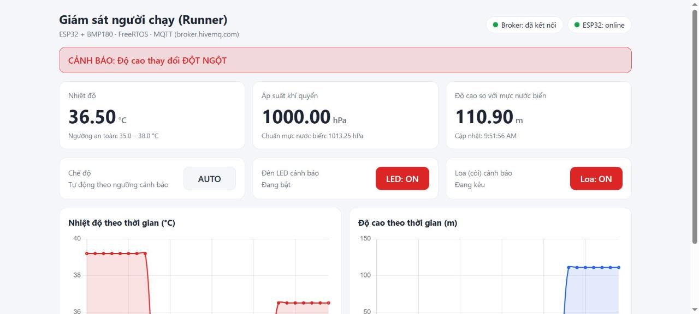
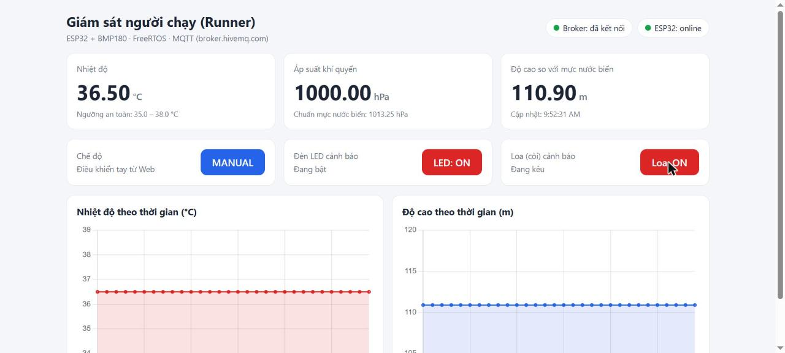

# Lab 3 – Mạch giám sát và cảnh báo người chạy (Runner) dùng FreeRTOS trên ESP32

**Môn:** Hệ thống nhúng · **Sinh viên:** Nguyễn Bá Việt Anh · **MSV:** 231432167

| | Link |
|---|---|
| Mô phỏng Wokwi | https://wokwi.com/projects/480087505731284993 |
| Giao diện Web | https://nguyenvietanh03012005-gif.github.io/Lab3-VietAnh-231432167/ |
| Báo cáo | [BaoCao-Lab3-VietAnh-231432167.docx](BaoCao-Lab3-VietAnh-231432167.docx) |

## Mô tả

ESP32 đọc nhiệt độ và áp suất khí quyển từ BMP180, tính độ cao so với mực nước biển, hiển thị qua Serial và gửi lên MQTT broker (`broker.hivemq.com`) qua WiFi. Giao diện Web hiển thị nhiệt độ, áp suất, độ cao dạng số, 2 biểu đồ thời gian thực và 2 nút điều khiển LED, loa cảnh báo (chế độ manual). Thiết bị cảnh báo bằng LED và còi khi nhiệt độ > 38 °C hoặc < 35 °C, hoặc độ cao thay đổi đột ngột (> 2 m/s).

## Tệp trong repo

| Tệp | Nội dung |
|---|---|
| `sketch.ino` | Code ESP32 (FreeRTOS, MQTT, BMP180) |
| `diagram.json` | Sơ đồ mạch Wokwi |
| `libraries.txt` | Thư viện: PubSubClient, Adafruit BMP085 Library, Adafruit BusIO |
| `index.html` | Giao diện Web (MQTT.js + Chart.js) |
| `BaoCao-Lab3-VietAnh-231432167.docx` | Báo cáo |

## Chân kết nối

| Thiết bị | Chân ESP32 |
|---|---|
| BMP180 SDA / SCL | GPIO21 / GPIO22 |
| LED đỏ cảnh báo | GPIO26 |
| LED xanh WiFi/MQTT | GPIO27 |
| Buzzer (loa) | GPIO25 |

## Các Task FreeRTOS

| Task | Lõi | Ưu tiên | Nhiệm vụ |
|---|---|---|---|
| TaskSendData (truyền data) | Core 0 | 1 | Kết nối WiFi, MQTT; nếu thành công lấy dữ liệu từ `dataQueue` gửi lên broker |
| TaskReadData (đọc data) | Core 1 | 2 | Đọc BMP180, in Serial, gửi vào `dataQueue` và `alertQueue` |
| TaskAlert (cảnh báo) | Core 1 | 3 | Đọc `alertQueue`, bật LED và còi khi vượt ngưỡng; điều khiển tay từ Web |

## Topic MQTT (gốc `esp32/runner/vietanh`)

| Topic | Chiều | Nội dung |
|---|---|---|
| `/data` | ESP32 → Web | nhiệt độ, áp suất, độ cao (JSON) |
| `/status` | ESP32 → Web | chế độ, trạng thái LED, loa, cảnh báo |
| `/cmd/led`, `/cmd/buzzer` | Web → ESP32 | `ON` / `OFF` |
| `/cmd/mode` | Web → ESP32 | `AUTO` / `MANUAL` |

## Kết quả

| Trường hợp | Wokwi | Web |
|---|---|---|
| Bình thường (36,5 °C) |  |  |
| Quá nhiệt (39,2 °C) |  |  |
| Dưới ngưỡng (34,0 °C) |  |  |
| Độ cao đổi đột ngột (1000 hPa → 110,9 m) |  |  |
| Điều khiển tay LED, loa (MANUAL) |  |  |

## Cách chạy

1. Mở link Wokwi, bấm **Start Simulation**.
2. Mở link giao diện Web; khi ESP32 kết nối, trang hiện **ESP32: online** và cập nhật dữ liệu mỗi giây.
3. Bấm vào BMP180 trên Wokwi để đổi nhiệt độ, áp suất; bấm nút LED, Loa trên Web để điều khiển.
